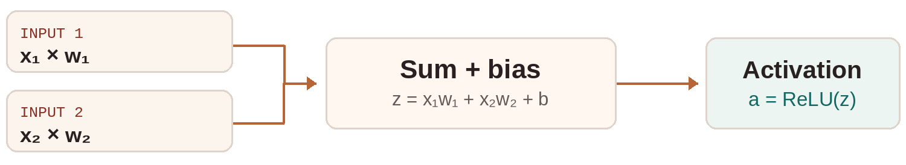
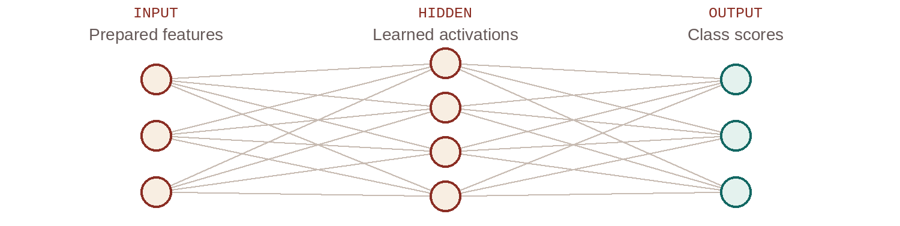
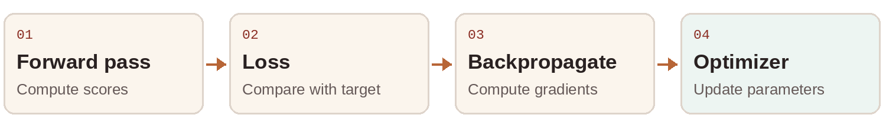
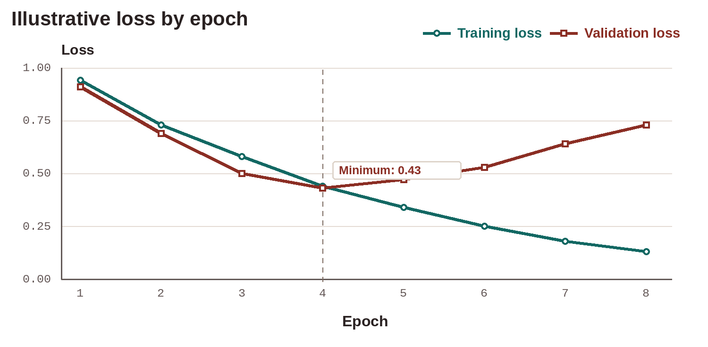
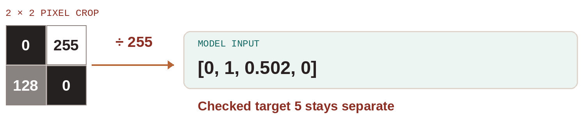
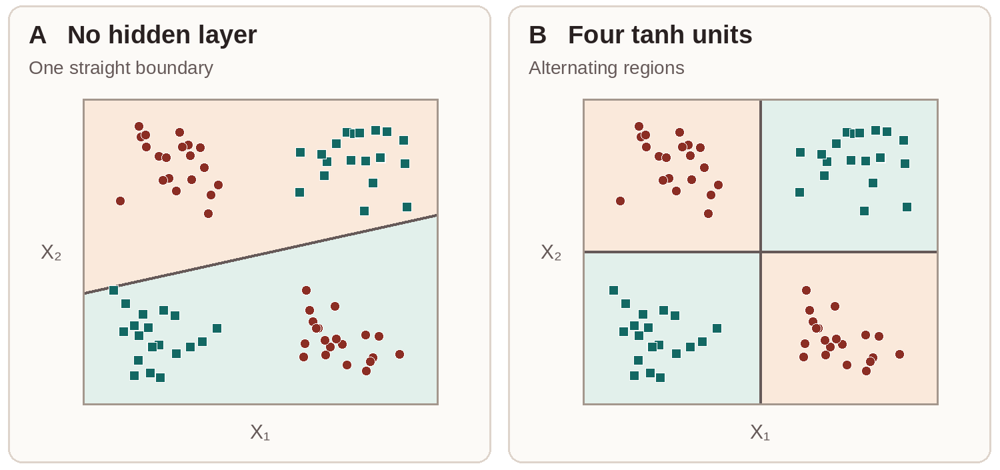

# Stage 2 Study Guide

**Big Data and Connectionist AI**

Team ALEKSANDRIA · Operation World Line · Version 1.2

A handwritten 5 enters the Future Gadget Lab. The scanner calls it a 3. Follow the evidence from the original image to the model's decision, then compare two networks in TensorFlow Playground.

**Audience** · University beginners studying Foundations of Computer Science & AI

## Start here

The guide follows one digit from raw scan to evaluation. Work through the chapters in order, then try the four activities before opening the worked answers.

| Where to go | What you will do |
|---|---|
| [01 Big Data](#big-data) | Describe the five Vs and decide which records are usable. |
| [02 Artificial neurons](#artificial-neurons) | Calculate a neuron's output and trace a layered network. |
| [03 Training and evaluation](#training-and-evaluation) | Explain loss, one weight update and evaluation on unseen data. |
| [04 Handwritten-digit recognition](#handwritten-digit-recognition) | Turn a scan into numbers and explain both prediction outcomes. |
| [Activities A–D](#activity-a-clean-the-scan-archive) | Clean, calculate, trace and test a network. |
| [Worked answers](#worked-answers-for-a-and-b) | Check your reasoning against the solutions. |
| [Learning resources](#learning-resources) | Extend the lesson with short reading and practice tasks. |
| [Glossary](#glossary-a-to-l) and [references](#references-and-image-credits) | Look up terminology and source material. |

**Before you start** · Use basic arithmetic, decimals and simple algebra. Have paper and a calculator for Activities A–C. Activity D uses a browser or the printed results. The story uses characters and locations from Steins;Gate. Every task supplies its own technical context.

### Team ALEKSANDRIA

| Member | Responsibility | Member | Responsibility |
|---|---|---|---|
| Aleksandr | Team coordination | Kamran | Repository and technical workflow |
| Grigory | Content | Mirad | Video |
| Tamerlan | Quality | Arseniy | Visual design |

*Akihabara Radio Kaikan, 2010 · Photograph by street viewer*

## Big Data

Daru receives digit scans, sensor readings and log files. Before he builds a model, he needs to know what arrives, whether he can trust it and what decision it should support.

Big Data describes data whose scale, speed or complexity calls for different ways to collect, store, process or analyse it. The five Vs help identify the problem in a particular system. A system can face several of these problems at once.

| Lens | Ask | Lab example |
|---|---|---|
| **Volume** | How much data is there? | Millions of archived scans take up storage and require time to process. |
| **Velocity** | How quickly does it arrive or need action? | Clipped-image alerts are useful while the parcel is still at the scanner. |
| **Variety** | What forms does it take? | Images, label tables and device logs need different handling. |
| **Veracity** | Can we trust it? | A well-formed row can still record the wrong digit. |
| **Value** | What useful decision does it support? | Earlier detection of clipped scans gives staff time to rescan them. |

### Recognise the data format

- **Structured** data follow a fixed schema, such as a table with scan ID, writer ID and checked label.
- **Semi-structured** data use keys or tags with a flexible record shape, such as JSON logs with optional error fields.
- **Unstructured** data include image or audio contents whose meaning is encoded in pixels or samples. A file's metadata can still be structured.

> **Quick check** · A service has ample storage but falls behind new readings. Which V is under pressure? **Answer** · Velocity, because the readings arrive faster than the system can process them.

[Source · IBM, What is Big Data?](https://www.ibm.com/think/topics/big-data)

## Prepare the scan archive

The lab needs images of the expected size, independently checked labels and a clear record of how it handled exceptions. Use these checks before splitting the data.

| Step | Action | Example |
|---|---|---|
| **Validate** | Check agreed rules for type, range and shape. | A digit label must be an integer from 0 to 9. A full scan needs 28 × 28 pixels. |
| **Clean** | Resolve or flag duplicates, missing values and known errors. | Keep one exact copy. Check an absent label against the original scan or hold the row for review. |
| **Transform** | Convert a valid record to the required units or representation. | Divide an 8-bit pixel by 255 to get a value from 0 to 1. |
| **Document** | Record the origin, decisions and exclusions. | Log the scan ID, what was checked and why the team rescanned or excluded it. |

Validation can catch a label of 12. It cannot establish that a plausible 5 is correct. Use the source image and a documented checking process to resolve doubtful labels. A clipped image should be rescanned when possible. Adding empty pixels can change the shape the classifier sees.

### Match the processing to the deadline

**Batch processing** groups records for a scheduled job, such as summarising yesterday's scans. **Stream processing** handles incoming events as they arrive, such as raising a clip alert. Storage holds records, networking moves them, and computing systems run the checks. Split work across machines when the required volume or rate warrants it.

> **Quick check** · One scan ID appears twice with identical pixels and labels. What goes into the dataset? **Answer** · One copy. If near-identical scans remain, group them into the same split so evaluation cannot benefit from having seen a copy.

Try [Activity A](#activity-a-clean-the-scan-archive) before reading the solution.

## Read the evidence

Collect across the writers, writing styles and scan conditions the model should handle. A thousand scans from one writer give a narrow sample even when every row is valid. If the question is how the model performs on new writers, reserve whole writers for evaluation and examine errors across relevant conditions.

| Type of analysis | Question to ask | Scan example |
|---|---|---|
| **Descriptive** | What happened? | How many scans were clipped each day? |
| **Diagnostic** | Why might it have happened? | Did the increase follow a change in scanner settings? |
| **Predictive** | What is likely next? | Which scans are likely to need a rescan? |
| **Prescriptive** | What should we do? | Which cases should staff review first given their time? |

Use a line chart for time-ordered measurements and a bar chart to compare counts by scanner. Label axes and units. If two scanners process different numbers of parcels, compare rates as well as counts. A pattern can suggest where to investigate. Verifying its cause requires further evidence.

### Handle personal information carefully

Keep only data needed for the task. A writer ID can help keep each writer's scans together without storing the writer's name in the training table. Limit access to the original scans and document a retention period. Encryption and access controls protect retained data. Data minimisation reduces how much is collected or kept in the first place.

> **Quick check** · Scanner A clips 4 of 20 images and scanner B clips 8 of 100. Which clips a larger share? **Answer** · A clips 20%. B clips 8%. The counts alone put them in the opposite order.

[Source · NIST AI Risk Management Framework](https://www.nist.gov/itl/ai-risk-management-framework)

## Artificial neurons

Kurisu starts with two adjustable weights. Each input is multiplied by its own weight, the products are added to a bias, and an activation function turns the sum into the neuron's output.

**With two inputs** · z = x₁ × w₁ + x₂ × w₂ + b. The output is a = activation(z).

| Setting | First product | Second product | Weighted sum z | ReLU output |
|---|---:|---:|---:|---:|
| Bias +0.10 | 0.8 × 0.5 = 0.40 | 0.2 × (−0.25) = −0.05 | 0.45 | 0.45 |
| Bias −0.50 | 0.40 | −0.05 | −0.15 | 0 |

**ReLU** returns the larger of 0 and z. Other activations include sigmoid, which maps to values between 0 and 1, and tanh, which maps to values between −1 and 1. An activation changes the mathematical relationship between inputs and output. Stacking only affine operations (rescale, combine and shift) still gives one affine operation. Nonlinear activations allow a network to combine features in more flexible ways.

> **Quick check** · If x₂ = 0, can a change in w₂ change this example's weighted sum? **Answer** · No. Its product is zero regardless of the weight.

Try [Activity B](#activity-b-calculate-a-neuron) to reproduce the two cases by hand.

## How layers make a prediction

A **connectionist** model uses many interconnected units. In a neural network, training adjusts numerical parameters so the combined units can detect useful patterns. A **symbolic** system can instead apply an explicit rule to facts. The scan lab can use both: a written rule can reject invalid image sizes, and a neural network can classify usable images.

The input layer supplies features. Hidden layers transform them and pass their activations forward. The output layer produces scores for the task. In a digit classifier, the largest class score selects the predicted digit. A raw score may need a transformation such as softmax before it can be interpreted as a class probability.

| Common architecture | Useful starting point |
|---|---|
| **Multilayer perceptron (MLP)** | Fixed-length feature vectors. A dense image baseline can read pixels in a fixed order and learn relationships among them. |
| **Convolutional neural network (CNN)** | Image grids. A filter reuses the same learned weights at different positions, so a local feature can be detected in many places. |

**Optional comparisons** · RNNs process sequences using information from earlier steps. LSTMs use gates to regulate that information. Diffusion models learn to generate data through a denoising process. The activities in this guide use dense networks and a digit-classification example.

[Sources · Google Neural Networks](https://developers.google.com/machine-learning/crash-course/neural-networks) · [Connectionism](https://plato.stanford.edu/entries/connectionism/) · [LSTM](https://doi.org/10.1162/neco.1997.9.8.1735) · [Diffusion](https://arxiv.org/abs/2006.11239)

## Training and evaluation

In supervised digit recognition, each training image has a checked label. The pixel values are the features. The checked digit provides the target used to compute loss.

| Stage | What it does |
|---|---|
| **Forward pass** | Uses current weights and biases to compute scores and choose a prediction. |
| **Loss calculation** | Compares the outputs with the target using a defined numerical measure. |
| **Backpropagation** | Calculates how sensitive the loss is to each parameter by working backward through the calculations. |
| **Optimizer update** | Uses those gradients to change the parameters. Repeat on more training examples. |

### Give each data split a job

| Split | Purpose |
|---|---|
| **Training** | Fit weights and biases. |
| **Validation** | Choose settings or a stopping point while developing the model. |
| **Test** | Evaluate the selected model on held-out examples with weights and settings fixed. |

When the same image or writer crosses splits, results can overstate how well the model works on new handwriting. Deduplicate exact copies and assign each writer to one split for a new-writer evaluation. Repeatedly tuning against the final test results also compromises their independence.

[Source · Google, Datasets: Dividing the original dataset](https://developers.google.com/machine-learning/crash-course/overfitting/dividing-datasets)

## Gradient descent

A gradient gives the local direction and magnitude of change in loss as a parameter changes. Basic gradient descent subtracts the gradient multiplied by the positive learning rate.

> **Update rule** · w_new = w_old − learning rate × gradient

| Supplied gradient | Weight calculation at rate 0.10 | New weight |
|---|---|---:|
| +0.20 | 0.40 − (0.10 × 0.20) | 0.38 |
| −0.30 | 0.40 − (0.10 × (−0.30)) | 0.43 |
| 0 | 0.40 − (0.10 × 0) | 0.40 |

Each row starts at the same weight. Tutorial 2 and the slides use the first row. Activity C uses the second so you can practise the minus sign. Both gradients are supplied for arithmetic practice. To know the next digit prediction, run a new forward pass with the full model and input.

### Repeat the training step

A **mini-batch** is a group of training examples used together for one update in mini-batch gradient descent. An **epoch** is one pass over the training set. With 100 examples in batches of 10, one epoch has 10 batches. A very small learning rate can make progress slow. A very large rate can make updates overshoot or become unstable.

**Inference** uses the learned parameters to make a prediction on a fresh input. In ordinary inference the parameters stay fixed. During evaluation the model also keeps parameters fixed, but its predictions can be compared with reference labels.

> **Quick check** · At a fixed nonzero gradient, what does doubling the learning rate do to one basic gradient-descent step? **Answer** · It doubles the update magnitude. The gradient sign still determines the direction.

[Source · 3Blue1Brown, Gradient descent, how neural networks learn](https://www.3blue1brown.com/lessons/gradient-descent/)

## Read training and validation loss

Generalisation means working on new examples under the intended conditions. In the example below, training loss keeps falling while validation loss rises after epoch 4. The gap is a warning that the model may be fitting training-specific patterns at the expense of performance on new data.

**Try it** · Which shown checkpoint would you select if your rule is lowest validation loss? Epoch 4. Its validation loss is 0.43. Check the selected checkpoint on a separate final test set after choosing it.

**Investigate the gap** · Check that the split matches the intended use and that labels are trustworthy. Compare earlier stopping, a simpler model or other settings using validation results. Review examples from different writers and scan conditions, since a single average can hide uneven errors.

**Compare two measures** · Accuracy counts the share of correct classifications. Loss can also respond to the probability assigned to the target. Two models can have the same accuracy and different losses.

[Source · Google, Overfitting](https://developers.google.com/machine-learning/crash-course/overfitting/overfitting)

## Handwritten-digit recognition

MNIST contains 70,000 labelled grayscale digit images of 28 × 28 pixels. Its published split is 60,000 training images and 10,000 test images. When developing a model, take a validation subset from the training portion and reserve the published test portion for final evaluation.

### Follow one scan

1. Verify the image shape and label. If part of the digit is clipped, check the original and rescan if possible.
2. For the example model, divide each 8-bit pixel by 255 and read values row by row. Apply the same representation to training, validation, test and fresh images.
3. Send the numbers into the network. Store the checked label separately for loss calculation or evaluation.

A dense baseline might have 784 inputs, a hidden layer and 10 output scores. A CNN can use the two-dimensional grid directly. The illustrated crop comes from a classroom example for a scan labelled 5. It lets you verify the arithmetic with four pixels. The complete image supplies 784.

> **Quick check** · Does the network need the checked label to make a prediction on a new scan? **Answer** · No. It takes the prepared pixels. A checked label lets us evaluate the prediction afterward.

[Sources · TensorFlow Datasets, MNIST](https://www.tensorflow.org/datasets/catalog/mnist) · [LeCun et al., Gradient-Based Learning Applied to Document Recognition](https://doi.org/10.1109/5.726791)

## Two predictions for a checked 5

Each column represents an independent illustrative scan with the same checked label. In each case the model picks the class with the largest individual probability. The other eight probabilities are grouped for space.

| Evidence | Case A · Incorrect | Case B · Correct |
|---|---:|---:|
| Probability of 3 | **0.60** | 0.12 |
| Probability of 5 | 0.30 | **0.82** |
| Other digits combined | 0.10 | 0.06 |
| Predicted digit | **3** | **5** |
| Checked target | 5 | 5 |
| Single-example cross-entropy | −ln(0.30) ≈ **1.204** | −ln(0.82) ≈ **0.198** |

For a single checked class, cross-entropy is −ln(p_target). Case B assigns more probability to the target and has a lower loss. Case A matches the example in the slides and second tutorial. Case B is a second example with supplied probabilities. Both are teaching values.

### Decide what happens after prediction

For a **training** image, the loss can lead to gradients and an update. For a **held-out test** image, record whether the model was correct and leave the parameters fixed. To compare error types, tally pairs of checked and predicted digits in a confusion matrix.

In a parcel routing workflow, use a documented escalation rule. The lab's sample policy sends a case to an operator when the highest probability is below 0.80. Case A is flagged because 0.60 is below the threshold. The operator should see the scan, check the destination and have authority to correct or escalate the route. Validate any real threshold using the costs and rates of both kinds of error.

[Practice · Activity C](#activity-c-trace-a-digit-prediction) · [Source · NIST AI Risk Management Framework](https://www.nist.gov/itl/ai-risk-management-framework)

## Activity A Clean the scan archive

Daru finds five rows in the archive. Decide which are ready for a digit dataset.

**Goal** · Use validation, deduplication and label checks to admit usable records.

**Preparation** · Use the scan log below. The second A17 row is an exact copy. A usable scan has 784 pixels and a verified label from 0 to 9. For this exercise, every present label was verified.

| Row | Scan ID | Writer | Checked label | Pixel count |
|---:|---|---|---:|---:|
| 1 | A17 | Kim | 5 | 784 |
| 2 | A17 | Kim | 5 | 784 |
| 3 | B04 | Lee | Missing | 784 |
| 4 | C09 | Jo | 3 | 784 |
| 5 | D11 | Sam | 8 | 780 |

**Task** · Mark each row **keep**, **duplicate** or **review**. Write what you would check before admitting a row flagged for review. Assign A17 to a single split.

**Observation** · Record the number and IDs of usable scans. List the evidence you used to make each decision.

**Reflection** · Which writers would you need to add or hold out if you wanted to evaluate new handwriting? Explain why a clean archive can still be unrepresentative.

**Feedback** · If an uncertain label is missing, look for the original record. Compare your decisions with [worked answers A–B](#worked-answers-for-a-and-b).

**Record your reasoning** · Use one line per reviewed row. Include the record ID, what is wrong and what evidence would resolve it.

## Activity B Calculate a neuron

Kurisu asks you to predict how a change in bias moves the output of a ReLU neuron.

**Goal** · Calculate a weighted sum, apply ReLU and explain the effect of a parameter change.

**Preparation** · Use x₁ = 0.8, x₂ = 0.2, w₁ = 0.5 and w₂ = −0.25. Start with b = +0.10, then set b = −0.50. Recall that ReLU(z) = max(0, z).

**Task** · Multiply each input by its weight. Add both products and the first bias to get z. Apply ReLU. Repeat with the second bias while holding the inputs and weights fixed.

**Observation** · Copy the table and fill in the weighted sum and activation for each run. Circle the row whose weighted sum is below zero.

| Run | Bias b | Weighted sum z | ReLU(z) |
|---|---:|---:|---:|
| 1 | +0.10 | ___ | ___ |
| 2 | −0.50 | ___ | ___ |

**Reflection** · Why did ReLU give different responses? Set x₂ = 0 and explain whether changing w₂ can affect this calculation.

**Feedback** · The second product is negative. Check your arithmetic and explanation in [worked answers A–B](#worked-answers-for-a-and-b).

**Record your reasoning** · Write one sentence explaining why the same inputs gave different outputs.

## Activity C Trace a digit prediction

The label on a parcel reads 5. The scanner recommends a route for 3. Trace each decision from the pixels to what the operator sees.

**Goal** · Keep the input, prediction, target and parameter update distinct. Decide how to handle a mistake during evaluation.

**Preparation** · The toy crop is [[0, 255], [128, 0]]. The whole scan has checked label 5. The model assigns 0.60 to 3, 0.30 to 5 and 0.10 to all other digits combined. For a separate update calculation, use weight 0.40, gradient −0.30 and learning rate 0.10.

**Task**

1. Flatten the crop row by row and divide by 255. Round each value to three decimal places if needed.
2. Record the predicted digit and checked label. Use the probability of the checked digit to estimate −ln(p_target), or use the supplied value −ln(0.30) ≈ 1.204.
3. Apply gradient descent to the supplied weight. Decide what would happen if the original scan were from a held-out test writer.
4. The sample policy requires review below 0.80. Decide what action to take on the parcel and what evidence the operator needs.

**Observation** · Record the vector, prediction, target, loss, new weight and routing decision. Mark which value belongs to the separate arithmetic example.

**Reflection** · What additional calculation would tell you the next prediction after changing a parameter?

**Feedback** · The largest probability and the probability of the checked label serve different purposes. Compare your trace with [worked answers C–D](#worked-answers-for-c-and-d).

## Activity D Compare two networks

Two lab configurations see the same points. One connects the two inputs directly to the output. The other adds a hidden layer. Which can draw a boundary for two classes that alternate across four quadrants?

**Goal** · Observe what changes when a nonlinear hidden layer is added and compare losses on data held out from fitting.

**Preparation** · Open [Run A · 0 hidden layers](https://playground.tensorflow.org/#activation=tanh&batchSize=10&dataset=xor&regDataset=reg-plane&learningRate=0.1&regularizationRate=0&noise=0&networkShape=&seed=0.31415&showTestData=true&discretize=false&percTrainData=50&x=true&y=true&xTimesY=false&xSquared=false&ySquared=false&cosX=false&sinX=false&cosY=false&sinY=false&collectStats=false&problem=classification&initZero=false&hideText=false) and [Run B · 1 hidden layer with 4 neurons](https://playground.tensorflow.org/#activation=tanh&batchSize=10&dataset=xor&regDataset=reg-plane&learningRate=0.1&regularizationRate=0&noise=0&networkShape=4&seed=0.31415&showTestData=true&discretize=false&percTrainData=50&x=true&y=true&xTimesY=false&xSquared=false&ySquared=false&cosX=false&sinX=false&cosY=false&sinY=false&collectStats=false&problem=classification&initZero=false&hideText=false) in separate tabs. TensorFlow Playground is a free English-language browser demo. It needs internet access, with no account or installation. Use the [offline worksheet](#playground-offline-worksheet) if the page is unavailable.

| Hold constant in both runs | Setting |
|---|---|
| Problem, dataset and seed | Classification · Exclusive or (XOR) · 0.31415 |
| Inputs and data | X₁ and X₂ only · 50% training · noise 0 · Show test data on |
| Training controls | Tanh · rate 0.1 · batch size 10 · regularisation None |

**Task**

1. Before running either tab, sketch where a straight line could divide the two classes. Predict which setup will have lower held-out loss.
2. In Run A, record Training loss and Test loss at epoch 0. Click **Step** (the skip-next icon) 12 times. Record both losses again and sketch the colour boundary.
3. In Run B, do the same through epoch 12. Reopen the preset in a new tab if you need to restart from the same state. Leave the dataset and the other settings fixed.

**Observation** · Compare both runs at the same epoch. Did the boundary separate alternating quadrants? How close were training and held-out losses?

**Reflection** · Explain what the hidden layer made possible. If you use the Playground's Test loss to choose settings, what additional data would you need for an independent final check?

**Feedback** · Compare with the [offline worksheet](#playground-offline-worksheet) and [worked answers C–D](#worked-answers-for-c-and-d).

## Playground offline worksheet

Use the recorded outputs if you cannot open the platform. The two runs used the settings on the preceding page. The additional run of B repeated the recorded values to three decimals.

| Run | Hidden layer | Epoch | Training loss | Playground Test loss |
|---|---|---:|---:|---:|
| A | None | 0 | 0.628 | 0.614 |
| A | None | 12 | 0.523 | 0.595 |
| B | 4 tanh units | 0 | 0.667 | 0.610 |
| B | 4 tanh units | 12 | 0.110 | 0.113 |

*Decision regions redrawn from the observed outputs. The markers illustrate the XOR pattern. The table gives the recorded losses.*

**Use the evidence**

1. By how much did the Playground Test loss drop from epoch 0 to 12 in each run?
2. Describe how the boundaries differ. Why is one straight boundary insufficient for this point pattern?
3. Which setting would you carry forward based on this run? Explain what a fresh test should check.

[Platform credit · Daniel Smilkov and Shan Carter, TensorFlow Playground](https://github.com/tensorflow/playground) · [Apache 2.0](https://github.com/tensorflow/playground/blob/master/LICENSE)

## Worked answers for A and B

### A Clean the scan archive

| Row | Decision | Reason or next step |
|---:|---|---|
| 1 · A17 | Keep | Verified label 5 and the expected 784 pixels. |
| 2 · A17 | Duplicate | Identical to row 1. Keep one copy in one split. |
| 3 · B04 | Review | Verify the missing label against the original scan. |
| 4 · C09 | Keep | Verified label 3 and the expected 784 pixels. |
| 5 · D11 | Review | Check what was lost. Rescan when possible. |

**Result** · Two usable scans, A17 and C09. Keeping copies across splits can leak the image into evaluation. Add scans from more relevant writers and scan conditions. Hold whole writers out when the question is how the model works on new people.

### B Calculate a neuron

| Step | Result |
|---|---|
| Multiply | 0.8 × 0.5 = 0.40 and 0.2 × (−0.25) = −0.05. |
| First bias | z = 0.40 − 0.05 + 0.10 = 0.45. ReLU gives 0.45. |
| Second bias | z = 0.40 − 0.05 − 0.50 = −0.15. ReLU gives 0. |
| Set x₂ = 0 | The second weighted input is 0 × w₂ = 0 for any w₂. |

The changed bias moves the weighted sum from above zero to below zero. ReLU preserves the positive value and clips the negative value to zero.

## Worked answers for C and D

### C Trace a digit prediction

1. Row order gives [0, 255, 128, 0]. Dividing by 255 gives [0, 1, 0.502, 0], rounded where needed.
2. Prediction **3** has probability 0.60. The checked target is **5**, with probability 0.30. The single-example loss is about 1.204.
3. For the separate training calculation, 0.40 − (0.10 × (−0.30)) = **0.43**. For a held-out scan, record the error with weights fixed.
4. Send the scan to a human under the sample policy. The highest probability is 0.60, below 0.80. The reviewer needs the image and the ability to correct or escalate the route.

**Reflection** · The next class requires a fresh forward pass with the complete model and its updated parameters. One weight calculation supplies only part of that information.

### D Compare two networks

- Run A's held-out loss dropped by **0.019**, from 0.614 to 0.595. Run B's dropped by **0.497**, from 0.610 to 0.113.
- With only X₁ and X₂, the zero-hidden-layer model gives a straight decision boundary. XOR places each class in two opposite quadrants. A single line cannot separate the alternating classes. The four tanh units let the second run combine nonlinear regions.
- Run B is the stronger candidate for these points and settings. The browser demo uses synthetic points and a squared-error objective. It provides no evidence of accuracy on handwritten digits.

**Reflection** · Treat the displayed held-out set as validation if you used it to choose a configuration. Use new held-out data for a final performance estimate. A new dataset or seed can give additional practice, but any claimed result should state the evaluation design.

### Module recap

Check that the archive represents the intended users. Turn the image into consistent numerical features and keep the checked label separate. Use loss and its gradients to guide training. Choose settings with validation data, then check the fixed model on an independent test set. Give a human enough evidence and authority to correct uncertain decisions.

## Learning resources

### 3Blue1Brown  But what is a neural network?

**Use** · Read or watch the part under “Recognizing handwritten digits.” Pause when the picture becomes a set of input activations. Sketch the image, a hidden layer and ten outputs. Where does the checked label enter a supervised training step?

**Check and fallback** · The pixels enter at the input. The label is compared with the prediction in the loss calculation. The lesson illustrates one network. Use [Artificial neurons](#artificial-neurons) and the [digit walkthrough](#handwritten-digit-recognition) for the same concept offline.

[Open Grant Sanderson's lesson](https://www.3blue1brown.com/lessons/neural-networks/)

### Google Machine Learning Crash Course  Dividing datasets

**Use** · Read “Validation set” and “Additional problems with test sets.” Sketch a split in which ten people contribute twenty scans each. Reserve two whole writers for validation and two for the final test. Where do the other six belong?

**Check and fallback** · The six remaining writers go into training. Grouping writers answers a new-writer question. If a site is unavailable, use the three split definitions in [Training and evaluation](#training-and-evaluation).

[Open Google's reading](https://developers.google.com/machine-learning/crash-course/overfitting/dividing-datasets)

### Team ALEKSANDRIA  Operation World Line

**Optional practice** · Use the game README to launch the local game. It needs Python 3.9 or newer, a browser and the complete downloaded game folder. Try Mission 3 at two learning rates from the same start. Record how many updates it takes to cross loss 0.30 and explain why the single synthetic neuron cannot establish digit-recognition accuracy.

**Fallback** · Use [Gradient descent](#gradient-descent) to compare the size of two steps at different learning rates and [Activity D](#activity-d-compare-two-networks) to compare fitted models. Tutorial 1 covers the scan at 01:15–03:45. Tutorial 2 covers prediction, loss and updating at 00:28–03:30.

[Game and setup](../interactive-learning/python-game/) · [Team video tutorial guide](../videos/Aleksandria_Stage2_VideoGuide.md)

## Glossary A to L

| Term | Meaning in this guide |
|---|---|
| **Accuracy** | Fraction of evaluated predictions that match the checked labels. |
| **Activation function** | Function applied to a neuron's weighted sum to produce its output. |
| **Affine transformation** | Weighted combination of inputs plus a constant offset. |
| **Backpropagation** | Algorithm that propagates loss derivatives backward to compute parameter gradients. |
| **Batch** | Group of examples processed together for one mini-batch update. |
| **Batch processing** | Collecting records and processing them together in a scheduled or triggered job. |
| **Bias** | In a neuron, a trainable offset. In a dataset or decision system, a systematic skew. |
| **Big Data** | Data whose scale, speed or complexity calls for different processing and management approaches. |
| **Classification** | Predicting a category, such as a digit from 0 to 9. |
| **CNN** | Convolutional neural network, which applies shared filters over positions in its input. |
| **Confusion matrix** | Counts arranged by actual and predicted classes so specific mistakes can be inspected. |
| **Connectionism** | Modelling behaviour using networks of interacting units. |
| **Cross-entropy** | Classification loss that, for one checked class, equals −ln of the probability assigned to that class. |
| **Data leakage** | Information improperly passes from evaluation or the future into training or model selection. |
| **Data minimisation** | Collecting and retaining only information needed for a stated purpose. |
| **Decision boundary** | Where a classifier changes its predicted class in the space of possible inputs. |
| **Deduplication** | Identifying repeated records and retaining or grouping them according to policy. |
| **Epoch** | One pass through the training set. |
| **Feature** | An input property supplied to a model, such as a numerical pixel value. |
| **Forward pass** | Calculation through the layers from inputs to outputs. |
| **Generalisation** | Performance on new examples under the intended conditions. |
| **Gradient** | Derivative or collection of derivatives showing local sensitivity of loss to parameters. |
| **Gradient descent** | Update method that subtracts the gradient scaled by a learning rate. |
| **Hidden layer** | A layer between input and output that transforms earlier values. |
| **Inference** | Using fitted parameters to calculate an output for an input. |
| **Label** | Known reference category attached to a supervised example. |
| **Learning rate** | Setting that scales the gradient in basic gradient descent. |
| **Loss** | A numerical measure of how well a model output matches a target under a chosen objective. |

## Glossary M to W

| Term | Meaning in this guide |
|---|---|
| **MLP** | Multilayer perceptron, a feedforward network typically built from dense layers. |
| **MNIST** | Published dataset of labelled 28 × 28 grayscale handwritten digits. |
| **Neural network** | A model of connected computing units with trainable parameters. |
| **Normalisation** | Rescaling numerical values using a consistent rule, such as pixel value ÷ 255. |
| **Optimizer** | Algorithm that uses gradients or related information to update parameters. |
| **Overfitting** | Fitting details of the training set at the expense of generalisation. |
| **Parameter** | A value fitted in training, such as a weight or bias. |
| **Prediction** | Class or value selected from a model's output. |
| **Preprocessing** | Checking, cleaning or transforming data before modelling. |
| **Regularisation** | A technique intended to improve generalisation by limiting how a model fits the training data. |
| **ReLU** | Rectified linear unit. Returns max(0, z). |
| **Representativeness** | Extent to which a dataset covers the cases and conditions relevant to its intended use. |
| **Score** | A numerical model output used to compare classes. A suitable transformation can convert scores to probabilities. |
| **Stream processing** | Processing incoming events as they arrive. |
| **Supervised learning** | Learning from examples paired with known targets. |
| **Target** | The checked label or reference value used when calculating loss or evaluating an example. |
| **Test set** | Held-out examples used for final evaluation of the selected model. |
| **Training set** | Examples used to fit the model's parameters. |
| **Validation check** | Rule-based check that incoming data meet an expected type, range or shape. |
| **Validation set** | Examples used to compare configurations or choose a stopping point during development. |
| **Value** | Usefulness of the data or its analysis for the intended task. |
| **Variety** | Range of data formats and sources. |
| **Veracity** | Trustworthiness of the data. |
| **Velocity** | Rate at which data arrive or need processing. |
| **Verification** | Checking whether a value or label agrees with the source evidence. |
| **Volume** | Amount of data. |
| **Weight** | Trainable multiplier that scales an input to a unit. |

## References and image credits

### Technical references

- IBM · [What is Big Data?](https://www.ibm.com/think/topics/big-data)
- Google for Developers · [Machine Learning Crash Course](https://developers.google.com/machine-learning/crash-course), especially Neural Networks and Datasets, Generalisation and Overfitting.
- Daniel Smilkov and Shan Carter · [TensorFlow Playground](https://playground.tensorflow.org/) and [source code](https://github.com/tensorflow/playground).
- Grant Sanderson · [But what is a neural network?](https://www.3blue1brown.com/lessons/neural-networks/) and [Gradient descent, how neural networks learn](https://www.3blue1brown.com/lessons/gradient-descent/).
- Stanford Encyclopedia of Philosophy · [Connectionism](https://plato.stanford.edu/entries/connectionism/).
- TensorFlow Datasets · [MNIST dataset catalogue](https://www.tensorflow.org/datasets/catalog/mnist). LeCun et al. (1998) · [Gradient-Based Learning Applied to Document Recognition](https://doi.org/10.1109/5.726791).
- NIST (2023) · [AI Risk Management Framework](https://www.nist.gov/itl/ai-risk-management-framework).
- Team ALEKSANDRIA · [Core Markdown chapters](../docs/chapters.md) and [tutorial guide](../videos/Aleksandria_Stage2_VideoGuide.md).

### Artwork

- *Steins;Gate (Steam HD Edition)* · [Future Gadget Laboratory](https://www.spriters-resource.com/pc_computer/steinsgatesteamhdedition/asset/107557/), [Daru](https://www.spriters-resource.com/pc_computer/steinsgatesteamhdedition/asset/107534/), [Kurisu](https://www.spriters-resource.com/pc_computer/steinsgatesteamhdedition/asset/107532/) and [divergence meter](https://www.spriters-resource.com/pc_computer/steinsgatesteamhdedition/asset/107527/). Archived by Adrot. Used here from the team's Operation World Line game.
- *Steins;Gate: Linear Bounded Phenogram* · [Okabe](https://www.spriters-resource.com/pc_computer/steinsgatelinearboundedphenogram/asset/153185/). Archived by delta. The game's artwork retains its original rights.
- street viewer · [Akihabara Radio Kaikan, 2010-03-06](https://commons.wikimedia.org/wiki/File:Akihabara_Radio_Kaikan,_2010-03-06.jpg). [CC BY 2.0](https://creativecommons.org/licenses/by/2.0/). Resized and cropped.
- Instrument Serif · [SIL Open Font License](https://github.com/google/fonts/blob/main/ofl/instrumentserif/OFL.txt).

Original teaching material and diagrams · Team ALEKSANDRIA · [CC BY 4.0](https://creativecommons.org/licenses/by/4.0/). Steins;Gate is the inspiration for this independent teaching resource.
